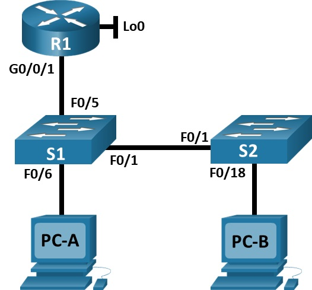

# Лабораторная работа. Конфигурация безопасности коммутатора.

## Топология:


## 1. Таблица адресации:

|   Устройство   | interface/vlan |   IP-адрес        |   Маска подсети  |  
|  ------------  |  ------------  |  --------------   | -----------------|
|  R1            |  G0/0/1        |  192.168.10.1     | 255.255.255.0    |
|  R1            |  Loopback 0    |  10.10.1.1        | 255.255.255.0    |
|  S1            |  VLAN 10       |  192.168.10.201   | 255.255.255.0    |
|  S2            |  VLAN 10       |  192.168.10.202   | 255.255.255.0    |
|  PC-A          |  NIC           |  DHCP             | 255.255.255.0    |
|  PC-B          |  NIC           |  DHCP             | 255.255.255.0    |

## Цели:

### Часть 1. Настройка основного сетевого устройства.

### Часть 2. Настройка сетей VLAN.

### Часть 3. Настройки безопасности коммутатора.

## Решение:

### Часть 1. Настройка основного сетевого устройства.

Шаг 1. Создайте сеть.

Шаг 2. Настройте маршрутизатор R1.

```
Router>enable
Router#configure terminal
Enter configuration commands, one per line.  End with CNTL/Z.
Router(config)#hostname R1
R1(config)#no ip domain lookup
R1(config)#ip dhcp excluded-address 192.168.10.1 192.168.10.9
R1(config)#ip dhcp excluded-address 192.168.10.201 192.168.10.202
R1(config)#ip dhcp relay information trust-all
R1(config)#!
R1(config)#ip dhcp pool Students
R1(dhcp-config)# network 192.168.10.0 255.255.255.0
R1(dhcp-config)# default-router 192.168.10.1
R1(dhcp-config)# domain-name CCNA2.Lab-11.6.1
R1(dhcp-config)#!
R1(dhcp-config)#interface Loopback0
R1(config-if)# ip address 10.10.1.1 255.255.255.0
R1(config-if)#!
R1(config-if)#interface GigabitEthernet0/0/1
R1(config-if)# description Link to S1
R1(config-if)# ip address 192.168.10.1 255.255.255.0
R1(config-if)# no shutdown
R1(config-if)#!
R1(config-if)#line con 0
R1(config-line)# logging synchronous
R1(config-line)# exec-timeout 0 0
R1#sh ip int br
Interface              IP-Address      OK? Method Status                Protocol 
GigabitEthernet0/0/0   unassigned      YES unset  administratively down down 
GigabitEthernet0/0/1   192.168.10.1    YES manual up                    up 
Loopback0              10.10.1.1       YES manual up                    up 
Vlan1                  unassigned      YES unset  administratively down down
```

Шаг 3. Настройка и проверка основных параметров коммутатора.

```
Switch>en
Switch#conf t
Switch(config)#hostname S1
S1(config)#no ip domain-lookup 
S1(config)#int f0/6
S1(config-if)#description Link to PC
S1(config-if)#int f0/1
S1(config-if)#description Link to S2
S1(config-if)#int f0/5
S1(config-if)#description Link to R1
S1(config)#ip default-gateway 192.168.10.1
```

```
Switch>en
Switch#conf t
Switch(config)#hostname S2
S2(config)#no ip domain-lookup 
S2(config)#int f0/18
S2(config-if)#description Link to PC
S2(config-if)#int f0/1
S2(config-if)#description Link to S1
S2(config)#ip default-gateway 192.168.10.1
```

### Часть 2. Настройка сетей VLAN.

```
S1(config)#vlan 10
S1(config-vlan)#name Management
S1(config-vlan)#int vlan 10
S1(config-if)#ip address 192.168.10.201 255.255.255.0
S1(config-if)#vlan 333
S1(config-vlan)#name Native
S1(config-vlan)#vlan 999
S1(config-vlan)#name ParkingLot
```

```
S2(config)#vlan 10
S2(config-vlan)#name Management
S2(config-vlan)#int vlan 10
S2(config-if)#ip address 192.168.10.202 255.255.255.0
S2(config-if)#vlan 333
S2(config-vlan)#name Native
S2(config-vlan)#vlan 999
S2(config-vlan)#name ParkingLot
```

### Часть 3. Настройки безопасности коммутатора.

Шаг 1. Релизация магистральных соединений 802.1Q.

```
S1(config)#int f0/1
S1(config-if)#sw mo tr
S1(config-if)#sw tr na vlan 333
S1(config-if)#sw nonegotiate
S1#sh int tru
Port        Mode         Encapsulation  Status        Native vlan
Fa0/1       on           802.1q         trunking      333

Port        Vlans allowed on trunk
Fa0/1       1-1005

Port        Vlans allowed and active in management domain
Fa0/1       1,10,333,999

Port        Vlans in spanning tree forwarding state and not pruned
Fa0/1       1,10,333,999
S1#sh int f0/1 sw | include Negotiation
Negotiation of Trunking: Off
```

```
S2(config)#int f0/1
S2(config-if)#sw mo tr
S2(config-if)#sw tr na vlan 333
S2(config-if)#sw nonegotiate
S2>sh int tr
Port        Mode         Encapsulation  Status        Native vlan
Fa0/1       on           802.1q         trunking      333

Port        Vlans allowed on trunk
Fa0/1       1-1005

Port        Vlans allowed and active in management domain
Fa0/1       1,10,333,999

Port        Vlans in spanning tree forwarding state and not pruned
Fa0/1       1,10,333,999
S2>sh int f0/1 sw | include Negotiation
Negotiation of Trunking: Off
```

Шаг 2. Настройка портов доступа.

```
S1(config)#int ra f0/5-6
S1(config-if-range)#sw mo ac
S1(config-if-range)#sw ac vlan 10
```

```
S2(config)#int f0/18
S2(config-if)#sw mo ac
S2(config-if)#sw ac vlan 10
```

Шаг 3. Безопасность неиспользуемых портов коммутатора.

```
S1(config)#int ra f0/2-4, f0/7-24, g0/1-2
S1(config-if-range)#sw mo ac
S1(config-if-range)#sw ac vlan 999
S1(config-if-range)#sh
S1#sh int sta
Port      Name               Status       Vlan       Duplex  Speed Type
Fa0/1     Link to S2         connected    trunk      a-full  a-100 10/100BaseTX
Fa0/2                        disabled 999        auto    auto  10/100BaseTX
Fa0/3                        disabled 999        auto    auto  10/100BaseTX
Fa0/4                        disabled 999        auto    auto  10/100BaseTX
Fa0/5     Link to R1         connected    10         a-full  a-100 10/100BaseTX
Fa0/6     Link to PC         connected    10         a-full  a-100 10/100BaseTX
Fa0/7                        disabled 999        auto    auto  10/100BaseTX
Fa0/8                        disabled 999        auto    auto  10/100BaseTX
Fa0/9                        disabled 999        auto    auto  10/100BaseTX
Fa0/10                       disabled 999        auto    auto  10/100BaseTX
Fa0/11                       disabled 999        auto    auto  10/100BaseTX
Fa0/12                       disabled 999        auto    auto  10/100BaseTX
Fa0/13                       disabled 999        auto    auto  10/100BaseTX
Fa0/14                       disabled 999        auto    auto  10/100BaseTX
Fa0/15                       disabled 999        auto    auto  10/100BaseTX
Fa0/16                       disabled 999        auto    auto  10/100BaseTX
Fa0/17                       disabled 999        auto    auto  10/100BaseTX
Fa0/18                       disabled 999        auto    auto  10/100BaseTX
Fa0/19                       disabled 999        auto    auto  10/100BaseTX
Fa0/20                       disabled 999        auto    auto  10/100BaseTX
Fa0/21                       disabled 999        auto    auto  10/100BaseTX
Fa0/22                       disabled 999        auto    auto  10/100BaseTX
Fa0/23                       disabled 999        auto    auto  10/100BaseTX
Fa0/24                       disabled 999        auto    auto  10/100BaseTX
Gig0/1                       disabled 999        auto    auto  10/100/1000BaseTX
Gig0/2                       disabled 999        auto    auto  10/100/1000BaseTX
```

```
S2(config)#int ra f0/2-17, f0/19-24, g0/1-2
S2(config-if-range)#sw mo ac
S2(config-if-range)#sw ac vlan 999
S2(config-if-range)#sh
S2#sh int sta
Port      Name               Status       Vlan       Duplex  Speed Type
Fa0/1     Link to S1         connected    trunk      a-full  a-100 10/100BaseTX
Fa0/2                        disabled 999        auto    auto  10/100BaseTX
Fa0/3                        disabled 999        auto    auto  10/100BaseTX
Fa0/4                        disabled 999        auto    auto  10/100BaseTX
Fa0/5                        disabled 999        auto    auto  10/100BaseTX
Fa0/6                        disabled 999        auto    auto  10/100BaseTX
Fa0/7                        disabled 999        auto    auto  10/100BaseTX
Fa0/8                        disabled 999        auto    auto  10/100BaseTX
Fa0/9                        disabled 999        auto    auto  10/100BaseTX
Fa0/10                       disabled 999        auto    auto  10/100BaseTX
Fa0/11                       disabled 999        auto    auto  10/100BaseTX
Fa0/12                       disabled 999        auto    auto  10/100BaseTX
Fa0/13                       disabled 999        auto    auto  10/100BaseTX
Fa0/14                       disabled 999        auto    auto  10/100BaseTX
Fa0/15                       disabled 999        auto    auto  10/100BaseTX
Fa0/16                       disabled 999        auto    auto  10/100BaseTX
Fa0/17                       disabled 999        auto    auto  10/100BaseTX
Fa0/18    Link to PC         connected    10         a-full  a-100 10/100BaseTX
Fa0/19                       disabled 999        auto    auto  10/100BaseTX
Fa0/20                       disabled 999        auto    auto  10/100BaseTX
Fa0/21                       disabled 999        auto    auto  10/100BaseTX
Fa0/22                       disabled 999        auto    auto  10/100BaseTX
Fa0/23                       disabled 999        auto    auto  10/100BaseTX
Fa0/24                       disabled 999        auto    auto  10/100BaseTX
Gig0/1                       disabled 999        auto    auto  10/100/1000BaseTX
Gig0/2                       disabled 999        auto    auto  10/100/1000BaseTX
```

Шаг 4. Документирование и реализация функций безопасности порта.

  Конфигурация безопасности порта по умолчанию  

| Функция | Настройка по умолчанию |
| --- | --- |
| Защита портов | Disabled |
| Максимальное количество записей MAC‑адресов | 1 |
| Режим проверки на нарушение безопасности | Shutdown |
| Aging Time | 0 мин |
| Aging Type | Absolute |
| Secure Static Address Aging | Disabled |
| Sticky MAC Address | 0 |

```
S1(config)#int f0/6
S1(config-if)#sw port-security 
S1(config-if)#sw port-security maximum 3
S1(config-if)#sw port-security violation restrict 
S1(config-if)#sw port-security aging time 60
```

Команда sw port-security aging type не работает в Cisco Packet Tracer.

```
S1#sh port-security int f0/6
Port Security              : Enabled
Port Status                : Secure-up
Violation Mode             : Restrict
Aging Time                 : 60 mins
Aging Type                 : Absolute
SecureStatic Address Aging : Disabled
Maximum MAC Addresses      : 3
Total MAC Addresses        : 1
Configured MAC Addresses   : 0
Sticky MAC Addresses       : 0
Last Source Address:Vlan   : 0005.5E7B.B496:10
Security Violation Count   : 0
```

```
S1#sh port-security address 
               Secure Mac Address Table
-----------------------------------------------------------------------------
Vlan    Mac Address       Type                          Ports   Remaining Age
                                                                   (mins)
----    -----------       ----                          -----   -------------
10	0005.5E7B.B496	DynamicConfigured	FastEthernet0/6		-
-----------------------------------------------------------------------------
Total Addresses in System (excluding one mac per port)     : 0
Max Addresses limit in System (excluding one mac per port) : 1024
```

```
S2(config)#int f0/18
S2(config-if)#sw port-security 
S2(config-if)#sw port-security mac-address sticky
S2(config-if)#sw port-security maximum 2
S2(config-if)#sw port-security violation protect 
S2(config-if)#sw port-security aging time 60
S2#sh port-security int f0/18
Port Security              : Enabled
Port Status                : Secure-up
Violation Mode             : Protect
Aging Time                 : 60 mins
Aging Type                 : Absolute
SecureStatic Address Aging : Disabled
Maximum MAC Addresses      : 2
Total MAC Addresses        : 1
Configured MAC Addresses   : 0
Sticky MAC Addresses       : 1
Last Source Address:Vlan   : 0009.7C10.6A8A:10
Security Violation Count   : 0
S2#sh port-security address 
               Secure Mac Address Table
-----------------------------------------------------------------------------
Vlan    Mac Address       Type                          Ports   Remaining Age
                                                                   (mins)
----    -----------       ----                          -----   -------------
  10    0009.7C10.6A8A    SecureSticky                  Fa0/18       -
-----------------------------------------------------------------------------
Total Addresses in System (excluding one mac per port)     : 0
Max Addresses limit in System (excluding one mac per port) : 1024
```

Шаг 5. Реализовать безопасность DHCP snooping.

```
S2(config)#ip dhcp snooping 
S2(config)#ip dhcp snooping vlan 10
S2(config)#int f0/18
S2(config-if)#ip dhcp snooping limit rate 5
S2(config-if)#int f0/1
S2(config-if)#ip dhcp snooping trust
S2#sh ip dhcp snooping 
Switch DHCP snooping is enabled
DHCP snooping is configured on following VLANs:
10
Insertion of option 82 is enabled
Option 82 on untrusted port is not allowed
Verification of hwaddr field is enabled
Interface                  Trusted    Rate limit (pps)
-----------------------    -------    ----------------
FastEthernet0/1            yes        unlimited       
FastEthernet0/18           no         5       
```

```
C:\>ipconfig /release

   IP Address......................: 0.0.0.0
   Subnet Mask.....................: 0.0.0.0
   Default Gateway.................: 0.0.0.0
   DNS Server......................: 0.0.0.0

C:\>ipconfig /renew

   IP Address......................: 192.168.10.10
   Subnet Mask.....................: 255.255.255.0
   Default Gateway.................: 192.168.10.1
   DNS Server......................: 0.0.0.0

S2#sh ip dhcp snooping binding 
MacAddress          IpAddress        Lease(sec)  Type           VLAN  Interface
------------------  ---------------  ----------  -------------  ----  -----------------
00:09:7C:10:6A:8A   192.168.10.10    0           dhcp-snooping  10    FastEthernet0/18
Total number of bindings: 1  
```

Шаг 6. Реализация PortFast и BPDU Guard.


```
S1(config)#int ra f0/5-6
S1(config-if-range)#spanning-tree portfast
S1(config)#spanning-tree portfast bpduguard default
S1#show spanning-tree interface f0/6 detail


Port 6 (FastEthernet0/6) of VLAN0010 is designated forwarding
  Port path cost 19, Port priority 128, Port Identifier 128.6
  Designated root has priority 32778, address 00E0.8FAD.810B
  Designated bridge has priority 32778, address 00E0.8FAD.810B
  Designated port id is 128.6, designated path cost 19
  Timers: message age 16, forward delay 0, hold 0
  Number of transitions to forwarding state: 1
  The port is in the portfast mode
  Link type is point-to-point by default
```

```
S2(config)#int f0/18
S2(config-if)#spanning-tree portfast
S2(config)#spanning-tree portfast bpduguard default
S2#sh spanning-tree int f0/18 detail 


Port 18 (FastEthernet0/18) of VLAN0010 is designated forwarding
  Port path cost 19, Port priority 128, Port Identifier 128.18
  Designated root has priority 32778, address 00E0.8FAD.810B
  Designated bridge has priority 32778, address 00E0.F92C.07B0
  Designated port id is 128.18, designated path cost 19
  Timers: message age 16, forward delay 0, hold 0
  Number of transitions to forwarding state: 1
  The port is in the portfast mode
  Link type is point-to-point by default
```

Шаг 7. Проверьте наличие сквозного подключения.

```
C:\>ping 192.168.10.10

Pinging 192.168.10.10 with 32 bytes of data:

Reply from 192.168.10.10: bytes=32 time<1ms TTL=128
Reply from 192.168.10.10: bytes=32 time<1ms TTL=128
Reply from 192.168.10.10: bytes=32 time<1ms TTL=128
Reply from 192.168.10.10: bytes=32 time<1ms TTL=128

Ping statistics for 192.168.10.10:
    Packets: Sent = 4, Received = 4, Lost = 0 (0% loss),
Approximate round trip times in milli-seconds:
    Minimum = 0ms, Maximum = 0ms, Average = 0ms
```

