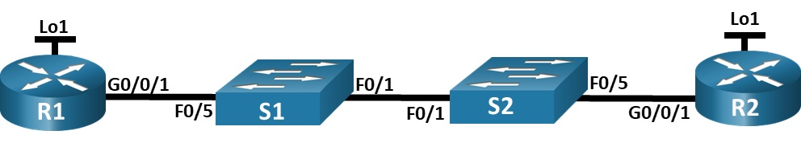

# Лабораторная работа. Настройка протокола OSPFv2 для одной области.

## Топология:


## 1. Таблица адресации:

|   Устройство   | interface    |   IP-адрес        |   Маска подсети  |  
|  ------------  |  ------------|  --------------   | -----------------|
|  R1            |  G0/0/1      |  10.53.0.1        | 255.255.255.0    |
|  R1            |  Loopback1   |  172.16.1.1       | 255.255.255.0    |
|  R2            |  G0/0/1      |  10.53.0.2        | 255.255.255.0    |
|  R2            |  Loopback1   |  192.168.1.1      | 255.255.255.0    |

## Цели:

### Часть 1. Создание сети и настройка основных параметров устройства.

### Часть 2. Настройка и проверка базовой работы протокола  OSPFv2 для одной области.

### Часть 3. Оптимизация и проверка конфигурации OSPFv2 для одной области.

## Решение:

### Часть 1. Создание сети и настройка основных параметров устройства.

Шаг 1. Шаг 1. Создайте сеть согласно топологии.

Шаг 2. Произведите базовую настройку маршрутизаторов.

```
Router>en
Router#conf t
Router(config)#hostname R1
R1(config)#no ip domain-lookup 
R1(config)#enable secret class
R1(config)#line con 0
R1(config-line)#password cisco
R1(config-line)#login
R1(config-line)#line vty 0 4
R1(config-line)#password cisco
R1(config-line)#login
R1(config-line)#exit
R1(config)#service password-encryption 
R1(config)#banner motd #Authorized Access Only!#
R1#copy run sta
Destination filename [startup-config]? 
Building configuration...
[OK]
```

```
Router>en
Router#conf t
Router(config)#hostname R2
R2(config)#no ip domain-lookup 
R2(config)#enable secret class
R2(config)#line con 0
R2(config-line)#password cisco
R2(config-line)#login
R2(config-line)#line vty 0 4
R2(config-line)#password cisco
R2(config-line)#login
R2(config-line)#exit
R2(config)#service password-encryption 
R2(config)#banner motd #Authorized Access Only!#
R2#copy run sta
Destination filename [startup-config]? 
Building configuration...
[OK]
```

Шаг 3. Настройте базовые параметры каждого коммутатора.

```
Switch>en
Switch#conf t
Switch(config)#hostname S1
S1(config)#no ip domain-lookup 
S1(config)#enable secret class
S1(config)#line con 0
S1(config-line)#password cisco
S1(config-line)#login
S1(config-line)#line vty 0 4
S1(config-line)#password cisco
S1(config-line)#login
S1(config-line)#exit
S1(config)#service password-encryption 
S1(config)#banner motd #Authorized Access Only!#
S1(config)#exit
S1#copy run sta
Destination filename [startup-config]? 
Building configuration...
[OK]
```

```
Switch>en
Switch#conf t
Switch(config)#hostname S2
S2(config)#no ip domain-lookup 
S2(config)#enable secret class
S2(config)#line con 0
S2(config-line)#password cisco
S2(config-line)#login
S2(config-line)#line vty 0 4
S2(config-line)#password cisco
S2(config-line)#login
S2(config-line)#exit
S2(config)#service password-encryption 
S2(config)#banner motd #Authorized Access Only!#
S2(config)#exit
S2#copy run sta
Destination filename [startup-config]? 
Building configuration...
[OK]
```

### Часть 2. Настройка и проверка базовой работы протокола  OSPFv2 для одной области.

Шаг 1. Настройте адреса интерфейса и базового OSPFv2 на каждом маршрутизаторе.

a.	Настройте адреса интерфейсов на каждом маршрутизаторе, как показано в таблице адресации выше.

```
R1(config)#int g0/0/1
R1(config-if)#ip ad
R1(config-if)#ip address 10.53.0.1 255.255.255.0
R1(config-if)#no sh
R1(config-if)#exit
R1(config)#int loopback 1
R1(config-if)#ip address 172.16.1.1 255.255.255.0
```

```
R2(config)#int g0/0/1
R2(config-if)#ip address 10.53.0.2 255.255.255.0
R2(config-if)#no sh
R2(config-if)#exit
R2(config)#int loopback 1
R2(config-if)#ip address 192.168.1.1 255.255.255.0
```

b.	Перейдите в режим конфигурации маршрутизатора OSPF, используя идентификатор процесса 56.

c.	Настройте статический идентификатор маршрутизатора для каждого маршрутизатора (1.1.1.1 для R1, 2.2.2.2 для R2).

d.	Настройте инструкцию сети для сети между R1 и R2, поместив ее в область 0.

e.	Только на R2 добавьте конфигурацию, необходимую для объявления сети Loopback 1 в область OSPF 0.

```
R1(config)#router ospf 56
R1(config-router)#router-id 1.1.1.1
R1(config-router)#network 10.53.0.0 0.0.0.255 area 0
```

```
R2(config)#router ospf 56
R2(config-router)#router-id 2.2.2.2
R2(config-router)#network 10.53.0.0 0.0.0.255 area 0
R2(config-router)#network 192.168.1.0 0.0.0.255 area 0
```

f.	Убедитесь, что OSPFv2 работает между маршрутизаторами. Выполните команду, чтобы убедиться, что R1 и R2 сформировали смежность.

```
R1#sh ip ospf neighbor 


Neighbor ID     Pri   State           Dead Time   Address         Interface
2.2.2.2           1   FULL/DR         00:00:31    10.53.0.2       GigabitEthernet0/0/1
```

```
R2#sh ip ospf neighbor 


Neighbor ID     Pri   State           Dead Time   Address         Interface
1.1.1.1           1   FULL/BDR        00:00:35    10.53.0.1       GigabitEthernet0/0/1
```

Какой маршрутизатор является DR? Какой маршрутизатор является BDR? Каковы критерии отбора?

Мы видим, что маршрутизатор 1.1.1.1 является BDR, 2.2.2.2 DR. Т.к. приоритет у них одинаковый, DR становится маршрутизатор с большим значением ID.

g.	На R1 выполните команду show ip route ospf, чтобы убедиться, что сеть R2 Loopback1 присутствует в таблице маршрутизации. 

```
R1#show ip route ospf
     192.168.1.0/32 is subnetted, 1 subnets
O       192.168.1.1 [110/2] via 10.53.0.2, 00:02:21, GigabitEthernet0/0/1
```

h.	Запустите Ping до адреса интерфейса R2 Loopback 1 из R1.

```
R1#ping 192.168.1.1

Type escape sequence to abort.
Sending 5, 100-byte ICMP Echos to 192.168.1.1, timeout is 2 seconds:
!!!!!
Success rate is 100 percent (5/5), round-trip min/avg/max = 0/0/3 ms
```

### Часть 3. Оптимизация и проверка конфигурации OSPFv2 для одной области.

Шаг 1. Реализация различных оптимизаций на каждом маршрутизаторе.

a.	На R1 настройте приоритет OSPF интерфейса G0/0/1 на 50, чтобы убедиться, что R1 является назначенным маршрутизатором.

```
R1(config)#int g0/0/1
R1(config-if)#ip ospf priority 50
```

b.	Настройте таймеры OSPF на G0/0/1 каждого маршрутизатора для таймера приветствия, составляющего 30 секунд.

```
R1(config)#int g0/0/1
R1(config-if)#ip ospf hello-interval 30
```

```
R2(config)#int g0/0/1
R2(config-if)#ip ospf hello-interval 30
```

c.	На R1 настройте статический маршрут по умолчанию, который использует интерфейс Loopback 1 в качестве интерфейса выхода.

```
R1(config)#ip route 0.0.0.0 0.0.0.0 loopback 1 172.16.1.1
R1(config)#router ospf 56
R1(config-router)#default-information originate 
```

d.	Добавьте конфигурацию, необходимую для OSPF для обработки R2 Loopback 1 как сети точка-точка.

```
R2(config)#int loopback 1
R2(config-if)#ip ospf network point-to-point
```

e.	Только на R2 добавьте конфигурацию, необходимую для предотвращения отправки объявлений OSPF в сеть Loopback 1.

```
R2(config)#router ospf 56
R2(config-router)#passive-interface loopback 1
```

f.	Измените базовую пропускную способность для маршрутизаторов.

```
R1(config)#router ospf 56
R1(config-router)#auto-cost reference-bandwidth 1000
R1#clear ip ospf process
```

```
R1(config)#router ospf 56
R1(config-router)#auto-cost reference-bandwidth 1000
R2#clear ip ospf process
```

Шаг 2. Убедитесь, что оптимизация OSPFv2 реализовалась.

a.	Выполните команду show ip ospf interface g0/0/1 на R1 и убедитесь, что приоритет интерфейса установлен равным 50, а временные интервалы — Hello 30, Dead 120, а тип сети по умолчанию — Broadcast

```
R1#show ip ospf interface g0/0/1

GigabitEthernet0/0/1 is up, line protocol is up
  Internet address is 10.53.0.1/24, Area 0
  Process ID 56, Router ID 1.1.1.1, Network Type BROADCAST, Cost: 10
  Transmit Delay is 1 sec, State DR, Priority 50
  Designated Router (ID) 1.1.1.1, Interface address 10.53.0.1
  Backup Designated Router (ID) 2.2.2.2, Interface address 10.53.0.2
  Timer intervals configured, Hello 30, Dead 120, Wait 40, Retransmit 5
    Hello due in 00:00:24
  Index 1/1, flood queue length 0
  Next 0x0(0)/0x0(0)
  Last flood scan length is 1, maximum is 1
  Last flood scan time is 0 msec, maximum is 0 msec
  Neighbor Count is 1, Adjacent neighbor count is 1
    Adjacent with neighbor 2.2.2.2  (Backup Designated Router)
  Suppress hello for 0 neighbor(s)
```

b.	На R1 выполните команду show ip route ospf, чтобы убедиться, что сеть R2 Loopback1 присутствует в таблице маршрутизации.

```
R1#show ip route ospf
O    192.168.1.0 [110/10] via 10.53.0.2, 00:06:10, GigabitEthernet0/0/1
```

c.	Введите команду show ip route ospf на маршрутизаторе R2. Единственная информация о маршруте OSPF должна быть распространяемый по умолчанию маршрут R1.

```
R2#show ip route ospf
O*E2 0.0.0.0/0 [110/1] via 10.53.0.1, 00:00:36, GigabitEthernet0/0/1
```

d.	Запустите Ping до адреса интерфейса R1 Loopback 1 из R2. 

```
R2#ping 172.16.1.1

Type escape sequence to abort.
Sending 5, 100-byte ICMP Echos to 172.16.1.1, timeout is 2 seconds:
!!!!!
Success rate is 100 percent (5/5), round-trip min/avg/max = 0/0/2 ms
```


