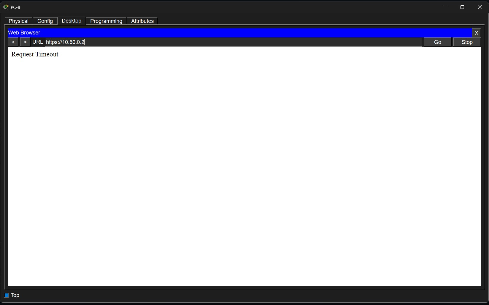
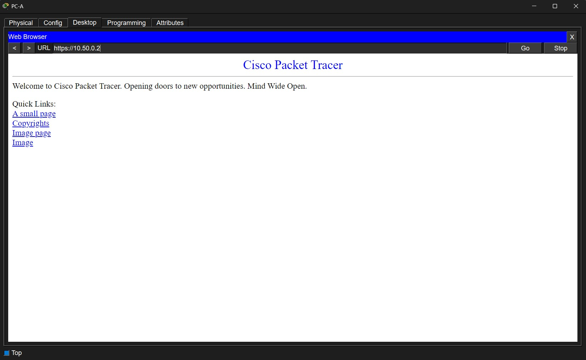

# Лабораторная работа. Настройка и проверка расширенных списков контроля доступа.

## Топология:


## Таблица адресации:

|   Устройство   | interface    |   IP-адрес        |   Маска подсети  |  Шлюз по умолчанию |
|  ------------  |  ------------|  --------------   | -----------------| -------------------|
|  R1            |  G0/0/1      |  -                | -                | -                  |
|  R1            |  G0/0/1.20   |  10.20.0.1        | 255.255.255.0    | -                  |
|  R1            |  G0/0/1.30   |  10.30.0.1        | 255.255.255.0    | -                  |
|  R1            |  G0/0/1.40   |  10.40.0.1        | 255.255.255.0    | -                  |
|  R1            |  G0/0/1000   |  -                | -                | -                  |
|  R1            |  Loopback1   |  172.16.1.1       | 255.255.255.0    | -                  |
|  R2            |  G0/0/1      |  10.20.0.4        | 255.255.255.0    | -                  |
|  S1            |  VLAN 20     |  10.20.0.2        | 255.255.255.0    | 10.20.0.1          |
|  S2            |  VLAN 20     |  10.20.0.3        | 255.255.255.0    | 10.20.0.1          |
|  PC-A          |  NIC         |  10.30.0.10       | 255.255.255.0    | 10.30.0.1          |
|  PC-B          |  NIC         |  10.40.0.10       | 255.255.255.0    | 10.40.0.1          |

## Таблица VLAN:

|   VLAN         |       Имя    |   Назначенный интерфейс                |        
|  ------------  |  ----------- |  ------------------------------------- |
|  20            |  Management  |  -                                     |
|  30            |  Operations  |  S1: F0/6                              |
|  40            |  Sales       |  S2: F0/18                             |
|  999           |  ParkingLot  |  S1: F0/2-4, F0/7-24, G0/1-2           |
|  999           |  ParkingLot  |  S2: F0/2-4, F0/6-17, F0/19-24, G0/1-2 |
|  1000          |  Native      |  -                                     |

## Цели:

### Часть 1. Создание сети и настройка основных параметров устройства.

### Часть 2. Настройка и проверка списков расширенного контроля доступа.

### Часть 3. Настройте транков (магистральных каналов).

### Часть 4. Настройка маршрутизации.

### Часть 5. Настройка удаленного доступа.

### Часть 6. Проверка подключения.

### Часть 7. Настройка и проверка списков контроля доступа (ACL)

## Решение:

### Часть 1. Создание сети и настройка основных параметров устройства.

Шаг 1. Создайте сеть согласно топологии.

Шаг 2. Произведите базовую настройку маршрутизаторов.

```
Router>en
Router#conf t
Router(config)#hostname R1
R1(config)#no ip domain-lookup 
R1(config)#enable secret class
R1(config)#line con 0
R1(config-line)#password cisco
R1(config-line)#login
R1(config-line)#line vty 0 4
R1(config-line)#password cisco
R1(config-line)#login
R1(config-line)#exit
R1(config)#service password-encryption 
R1(config)#banner motd #Authorized Access Only!#
R1#copy run sta
Destination filename [startup-config]? 
Building configuration...
[OK]
```


```
Router>en
Router#conf t
Router(config)#hostname R2
R2(config)#no ip domain-lookup 
R2(config)#enable secret class
R2(config)#line con 0
R2(config-line)#password cisco
R2(config-line)#login
R2(config-line)#line vty 0 4
R2(config-line)#password cisco
R2(config-line)#login
R2(config-line)#exit
R2(config)#service password-encryption 
R2(config)#banner motd #Authorized Access Only!#
R2#copy run sta
Destination filename [startup-config]? 
Building configuration...
[OK]
```

Шаг 3. Настройте базовые параметры каждого коммутатора.

```
Switch>en
Switch#conf t
Switch(config)#hostname S1
S1(config)#no ip domain-lookup 
S1(config)#enable secret class
S1(config)#line con 0
S1(config-line)#password cisco
S1(config-line)#login
S1(config-line)#line vty 0 4
S1(config-line)#password cisco
S1(config-line)#login
S1(config-line)#exit
S1(config)#service password-encryption 
S1(config)#banner motd #Authorized Access Only!#
S1(config)#exit
S1#copy run sta
Destination filename [startup-config]? 
Building configuration...
[OK]
```

```
Switch>en
Switch#conf t
Switch(config)#hostname S2
S2(config)#no ip domain-lookup 
S2(config)#enable secret class
S2(config)#line con 0
S2(config-line)#password cisco
S2(config-line)#login
S2(config-line)#line vty 0 4
S2(config-line)#password cisco
S2(config-line)#login
S2(config-line)#exit
S2(config)#service password-encryption 
S2(config)#banner motd #Authorized Access Only!#
S2(config)#exit
S2#copy run sta
Destination filename [startup-config]? 
Building configuration...
[OK]
```

### Часть 2. Настройка сетей VLAN на коммутаторах.

Шаг 1. Создайте сети VLAN на коммутаторах.

```
S1(config)#vlan 20
S1(config-vlan)#name Management
S1(config-vlan)#vlan 30
S1(config-vlan)#name Operations
S1(config-vlan)#vlan 40
S1(config-vlan)#name Sales
S1(config-vlan)#vlan 999
S1(config-vlan)#name ParkingLot
S1(config-vlan)#vlan 1000
S1(config-vlan)#name Native
S1(config-vlan)#exit
S1(config)#int vlan 20
S1(config-if)#ip address 10.20.0.2 255.255.255.0
S1(config-if)#exit
S1(config)#ip default-gateway 10.20.0.1
S1(config)#int ra f0/2-4, f0/7-24, g0/1-2
S1(config-if-range)#sw mo ac
S1(config-if-range)#sw ac vlan 999
```

```
S2(config)#vlan 20
S2(config-vlan)#name Management
S2(config-vlan)#vlan 30
S2(config-vlan)#name Operations
S2(config-vlan)#vlan 40
S2(config-vlan)#name Sales
S2(config-vlan)#vlan 999
S2(config-vlan)#name ParkingLot
S2(config-vlan)#vlan 1000
S2(config-vlan)#name Native
S2(config-vlan)#int vlan 20
S2(config-if)#ip address 10.20.0.3 255.255.255.0
S2(config-if)#exit
S2(config)#ip default-gateway 10.20.0.1
S2(config)#int ra f0/2-4, f0/6-17, f0/19-24, g0/1-2
S2(config-if-range)#sw mo ac
S2(config-if-range)#sw ac vlan 999
```

Шаг 2. Назначьте сети VLAN соответствующим интерфейсам коммутатора.

```
S1(config)#int f0/6
S1(config-if)#sw mo ac
S1(config-if)#sw ac vlan 30
S1#sh vlan br

VLAN Name                             Status    Ports
---- -------------------------------- --------- -------------------------------
1    default                          active    Fa0/1, Fa0/5
20   Management                       active    
30   Operations                       active    Fa0/6
40   Sales                            active    
999  ParkingLot                       active    Fa0/2, Fa0/3, Fa0/4, Fa0/7
                                                Fa0/8, Fa0/9, Fa0/10, Fa0/11
                                                Fa0/12, Fa0/13, Fa0/14, Fa0/15
                                                Fa0/16, Fa0/17, Fa0/18, Fa0/19
                                                Fa0/20, Fa0/21, Fa0/22, Fa0/23
                                                Fa0/24, Gig0/1, Gig0/2
1000 Native                           active    
1002 fddi-default                     active    
1003 token-ring-default               active    
1004 fddinet-default                  active    
1005 trnet-default                    active 
```

```
S2(config)#int f0/18
S2(config-if)#sw mo ac
S2(config-if)#sw ac vlan 40
S2(config-if)#end
S2#sh vlan br

VLAN Name                             Status    Ports
---- -------------------------------- --------- -------------------------------
1    default                          active    Fa0/1, Fa0/5
20   Management                       active    
30   Operations                       active    
40   Sales                            active    Fa0/18
999  ParkingLot                       active    Fa0/2, Fa0/3, Fa0/4, Fa0/6
                                                Fa0/7, Fa0/8, Fa0/9, Fa0/10
                                                Fa0/11, Fa0/12, Fa0/13, Fa0/14
                                                Fa0/15, Fa0/16, Fa0/17, Fa0/19
                                                Fa0/20, Fa0/21, Fa0/22, Fa0/23
                                                Fa0/24, Gig0/1, Gig0/2
1000 Native                           active    
1002 fddi-default                     active    
1003 token-ring-default               active    
1004 fddinet-default                  active    
1005 trnet-default                    active    
```

### Часть 3. Настройте транки (магистральные каналы).

Шаг 1. Вручную настройте магистральный интерфейс F0/1.

```
S1(config)#int f0/1
S1(config-if)#sw mo tr
S1(config-if)#sw trunk native vlan 1000
S1(config-if)#sw tr allowed vlan 20,30,40,1000
S1(config-if)#end
S1#sh int tru
Port        Mode         Encapsulation  Status        Native vlan
Fa0/1       on           802.1q         trunking      1000

Port        Vlans allowed on trunk
Fa0/1       20,30,40,1000

Port        Vlans allowed and active in management domain
Fa0/1       20,30,40,1000

Port        Vlans in spanning tree forwarding state and not pruned
Fa0/1       20,30,40,1000
```

```
S2(config)#int f0/1
S2(config-if)#sw mo tr
S2(config-if)#sw tr native vlan 1000
S2(config-if)#sw tr allowed vlan 20,30,40,1000
S2(config-if)#end
S2#sh int tru
Port        Mode         Encapsulation  Status        Native vlan
Fa0/1       on           802.1q         trunking      1000

Port        Vlans allowed on trunk
Fa0/1       20,30,40,1000

Port        Vlans allowed and active in management domain
Fa0/1       20,30,40,1000

Port        Vlans in spanning tree forwarding state and not pruned
Fa0/1       none
```

Шаг 2. Вручную настройте магистральный интерфейс F0/5 на коммутаторе S1.

```
S1(config)#int f0/5
S1(config-if)#sw mo tr
S1(config-if)#sw tr native vlan 1000
S1(config-if)#sw tr allowed vlan 20,30,40,1000
S1(config-if)#end
S1#sh int tru
Port        Mode         Encapsulation  Status        Native vlan
Fa0/1       on           802.1q         trunking      1000
Fa0/5       on           802.1q         trunking      1000

Port        Vlans allowed on trunk
Fa0/1       20,30,40,1000
Fa0/5       20,30,40,1000

Port        Vlans allowed and active in management domain
Fa0/1       20,30,40,1000
Fa0/5       20,30,40,1000

Port        Vlans in spanning tree forwarding state and not pruned
Fa0/1       20,30,40,1000
Fa0/5       20,30,40,1000
```

### Часть 4. Настройте маршрутизацию.

Шаг 1. Настройка маршрутизации между сетями VLAN на R1.

```
R1#conf t
R1(config)#int g0/0/1
R1(config-if)#no sh
R1(config-if)#int g0/0/1.20
R1(config-subif)#encapsulation dot1Q 20
R1(config-subif)#ip ad 10.20.0.1 255.255.255.0
R1(config-subif)#description Default Gateway for VLAN 20 Management
R1(config-subif)#int g0/0/1.30
R1(config-subif)#encapsulation dot1Q 30
R1(config-subif)#ip address 10.30.0.1 255.255.255.0
R1(config-subif)#description Default Gateway for VLAN 30 Operations
R1(config-subif)#int g0/0/1.40
R1(config-subif)#encapsulation dot1Q 40
R1(config-subif)#ip address 10.40.0.1 255.255.255.0
R1(config-subif)#description Default Gateway for VLAN 40 Sales
R1(config-subif)#int g0/0/1.1000
R1(config-subif)#encapsulation dot1Q 1000 native
R1(config-subif)#description Native VLAN
R1(config)#int loopback 1
R1(config-if)#ip address 172.16.1.1 255.255.255.0
```

```
R1#sh ip int br
Interface              IP-Address      OK? Method Status                Protocol 
GigabitEthernet0/0/0   unassigned      YES unset  administratively down down 
GigabitEthernet0/0/1   unassigned      YES unset  up                    up 
GigabitEthernet0/0/1.2010.20.0.1       YES manual up                    up 
GigabitEthernet0/0/1.3010.30.0.1       YES manual up                    up 
GigabitEthernet0/0/1.4010.40.0.1       YES manual up                    up 
GigabitEthernet0/0/1.1000unassigned      YES unset  up                    up 
Loopback1              172.16.1.1      YES manual up                    up 
Vlan1                  unassigned      YES unset  administratively down down
```

Шаг 2. Настройка интерфейса R2 g0/0/1 с использованием адреса из таблицы и маршрута по умолчанию с адресом следующего перехода 10.20.0.1.

```
R2>en
Password: 
R2#conf t
R2(config)#int g0/0/1
R2(config-if)#ip address 10.20.0.4 255.255.255.0
R2(config-if)#no sh
R2(config-if)#exi
R2(config)#ip route 0.0.0.0 0.0.0.0 10.20.0.1
```

### Часть 5. Настройте удаленный доступ.

Шаг 1. Настройте все сетевые устройства для базовой поддержки SSH.

```
S1(config)#username sshadmin privilege 15 secret $cisco123!
S1(config)#ip domain-name ccna-lab.com
S1(config)#crypto key generate rsa
The name for the keys will be: S1.ccna-lab.com
Choose the size of the key modulus in the range of 360 to 4096 for your
  General Purpose Keys. Choosing a key modulus greater than 512 may take
  a few minutes.

How many bits in the modulus [512]: 1024
% Generating 1024 bit RSA keys, keys will be non-exportable...[OK]

S1(config)#ip ssh version 2
S1(config)#line vty 0 4
S1(config-line)#login local 
S1(config-line)#transport input ssh
```

```
S2(config)#username sshadmin privilege 15 secret $cisco123!
S2(config)#ip domain-name ccna-lab.com
S2(config)#crypto key generate rsa
The name for the keys will be: S2.ccna-lab.com
Choose the size of the key modulus in the range of 360 to 4096 for your
  General Purpose Keys. Choosing a key modulus greater than 512 may take
  a few minutes.

How many bits in the modulus [512]: 1024
% Generating 1024 bit RSA keys, keys will be non-exportable...[OK]

S2(config)#ip ssh version 2
*Mar 1 2:3:37.410: %SSH-5-ENABLED: SSH 1.99 has been enabled
S2(config)#line vty 0 4
S2(config-line)#login local 
S2(config-line)#transport input ssh
```

```
R1(config)#username sshadmin privilege 15 secret $cisco123!
R1(config)#ip domain-name ccna-lab.com
R1(config)#crypto key generate rsa
The name for the keys will be: R1.ccna-lab.com
Choose the size of the key modulus in the range of 360 to 4096 for your
  General Purpose Keys. Choosing a key modulus greater than 512 may take
  a few minutes.
How many bits in the modulus [512]: 1024
% Generating 1024 bit RSA keys, keys will be non-exportable...[OK]
R1(config)#ip ssh version 2
*Mar 1 2:7:11.431: %SSH-5-ENABLED: SSH 1.99 has been enabled
R1(config)#line vty 0 4
R1(config-line)#login local
R1(config-line)#tra
R1(config-line)#transport in
R1(config-line)#transport input ssh
```

```
R2(config)#username sshadmin privilege 15 secret $cisco123!
R2(config)#ip domain-name ccna-lab.com
R2(config)#crypto key generate rsa
The name for the keys will be: R2.ccna-lab.com
Choose the size of the key modulus in the range of 360 to 4096 for your
  General Purpose Keys. Choosing a key modulus greater than 512 may take
  a few minutes.
How many bits in the modulus [512]: 1024
% Generating 1024 bit RSA keys, keys will be non-exportable...[OK]
R2(config)#ip ssh version 2
*Mar 1 2:8:48.244: %SSH-5-ENABLED: SSH 1.99 has been enabled
R2(config)#line vty 0 4
R2(config-line)#login local
R2(config-line)#transport input ssh
```

Шаг 2. Включите защищенные веб-службы с проверкой подлинности на R1.

Так как в CPT нет возможности создать https, добавим сервер на порт g0/0/0.

Присвоим IP 10.50.0.2 /24, шлюз будет 10.50.0.1 /24.

### Часть 6. Проверка подключения.

С PC-A

```
C:\>ping 10.40.0.10

Pinging 10.40.0.10 with 32 bytes of data:

Reply from 10.40.0.10: bytes=32 time<1ms TTL=127
Reply from 10.40.0.10: bytes=32 time=3ms TTL=127
Reply from 10.40.0.10: bytes=32 time<1ms TTL=127
Reply from 10.40.0.10: bytes=32 time=3ms TTL=127

Ping statistics for 10.40.0.10:
    Packets: Sent = 4, Received = 4, Lost = 0 (0% loss),
Approximate round trip times in milli-seconds:
    Minimum = 0ms, Maximum = 3ms, Average = 1ms
```

```
C:\>ping 10.20.0.1

Pinging 10.20.0.1 with 32 bytes of data:

Reply from 10.20.0.1: bytes=32 time<1ms TTL=255
Reply from 10.20.0.1: bytes=32 time=3ms TTL=255
Reply from 10.20.0.1: bytes=32 time<1ms TTL=255
Reply from 10.20.0.1: bytes=32 time<1ms TTL=255

Ping statistics for 10.20.0.1:
    Packets: Sent = 4, Received = 4, Lost = 0 (0% loss),
Approximate round trip times in milli-seconds:
    Minimum = 0ms, Maximum = 3ms, Average = 0ms
```

C PC-B

```
C:\>ping 10.30.0.10

Pinging 10.30.0.10 with 32 bytes of data:

Reply from 10.30.0.10: bytes=32 time<1ms TTL=127
Reply from 10.30.0.10: bytes=32 time<1ms TTL=127
Reply from 10.30.0.10: bytes=32 time<1ms TTL=127
Reply from 10.30.0.10: bytes=32 time<1ms TTL=127

Ping statistics for 10.30.0.10:
    Packets: Sent = 4, Received = 4, Lost = 0 (0% loss),
Approximate round trip times in milli-seconds:
    Minimum = 0ms, Maximum = 0ms, Average = 0ms
```

```
C:\>ping 10.20.0.1

Pinging 10.20.0.1 with 32 bytes of data:

Reply from 10.20.0.1: bytes=32 time<1ms TTL=255
Reply from 10.20.0.1: bytes=32 time<1ms TTL=255
Reply from 10.20.0.1: bytes=32 time<1ms TTL=255
Reply from 10.20.0.1: bytes=32 time<1ms TTL=255

Ping statistics for 10.20.0.1:
    Packets: Sent = 4, Received = 4, Lost = 0 (0% loss),
Approximate round trip times in milli-seconds:
    Minimum = 0ms, Maximum = 0ms, Average = 0ms
```

```
C:\>ping 172.16.1.1

Pinging 172.16.1.1 with 32 bytes of data:

Reply from 172.16.1.1: bytes=32 time<1ms TTL=255
Reply from 172.16.1.1: bytes=32 time<1ms TTL=255
Reply from 172.16.1.1: bytes=32 time<1ms TTL=255
Reply from 172.16.1.1: bytes=32 time<1ms TTL=255

Ping statistics for 172.16.1.1:
    Packets: Sent = 4, Received = 4, Lost = 0 (0% loss),
Approximate round trip times in milli-seconds:
    Minimum = 0ms, Maximum = 0ms, Average = 0ms
```

```
C:\>ping 10.50.0.2

Pinging 10.50.0.2 with 32 bytes of data:

Reply from 10.50.0.2: bytes=32 time<1ms TTL=127
Reply from 10.50.0.2: bytes=32 time<1ms TTL=127
Reply from 10.50.0.2: bytes=32 time<1ms TTL=127
Reply from 10.50.0.2: bytes=32 time<1ms TTL=127

Ping statistics for 10.50.0.2:
    Packets: Sent = 4, Received = 4, Lost = 0 (0% loss),
Approximate round trip times in milli-seconds:
    Minimum = 0ms, Maximum = 0ms, Average = 0ms
```

```
C:\>ssh -l sshadmin 10.20.0.1

Password: 

Authorized Access Only!

R1#
```

```
C:\>ssh -l sshadmin 172.16.1.1

Password:

Authorized Access Only!

R1#
```

### Часть 7. Настройка и проверка списков контроля доступа (ACL).

Шаг 1. Проанализируйте требования к сети и политике безопасности для планирования реализации ACL.

Политика 1. Сеть Sales не может использовать SSH в сети Management (но в  другие сети SSH разрешен).

Политика 2. Сеть Sales не имеет доступа по протоколу http\https на сервере 10.50.0.2 (Изменил из-за ограничений CPT)

Политика 3. Сеть Sales не может отправлять эхо-запросы ICMP в сети Operations или Management. Разрешены эхо-запросы ICMP к другим адресатам.

Политика 4. Cеть Operations не может отправлять ICMP эхо-запросы в сеть Sales. Разрешены эхо-запросы ICMP к другим адресатам. 

Шаг 2. Разработка и применение расширенных списков доступа, которые будут соответствовать требованиям политики безопасности.

Создадим ACL для VLAN Sales и назначим его на интерфейс g0/0/1.40.

```
R1(config)#ip access-list extended ACL_SALES
R1(config-ext-nacl)#deny tcp 10.40.0.0 0.0.0.255 10.20.0.0 0.0.0.255 eq 22
R1(config-ext-nacl)#deny tcp 10.40.0.0 0.0.0.255 10.50.0.0 0.0.0.255 eq 80
R1(config-ext-nacl)#deny tcp 10.40.0.0 0.0.0.255 10.50.0.0 0.0.0.255 eq 443
R1(config-ext-nacl)#deny icmp 10.40.0.0 0.0.0.255 10.30.0.0 0.0.0.255 echo
R1(config-ext-nacl)#deny icmp 10.40.0.0 0.0.0.255 10.20.0.0 0.0.0.255 echo
R1(config-ext-nacl)#permit ip any any
R1(config)#int g0/0/1.40
R1(config-subif)#ip access-group ACL_SALES in
```

Создадим ACL для VLAN Operations и назначим его на интерфейс g0/0/1.30.

```
R1(config)#ip access-list extended ACL_OPERATIONS
R1(config-ext-nacl)#deny icmp 10.30.0.0 0.0.0.255 10.40.0.0 0.0.0.255 echo
R1(config-ext-nacl)#permit ip any
R1(config-subif)#int g0/0/1.30
R1(config-subif)#ip access-group ACL_OPERATIONS in
```

Шаг 3. Убедитесь, что политики безопасности применяются развернутыми списками доступа.

С PC-A PING 10.40.0.10 - Сбой

```
C:\>ping 10.40.0.10

Pinging 10.40.0.10 with 32 bytes of data:

Reply from 10.30.0.1: Destination host unreachable.
Reply from 10.30.0.1: Destination host unreachable.
Reply from 10.30.0.1: Destination host unreachable.
Reply from 10.30.0.1: Destination host unreachable.

Ping statistics for 10.40.0.10:
    Packets: Sent = 4, Received = 0, Lost = 4 (100% loss)
```

С PC-A PING 10.20.0.1 - Успех

```
C:\>ping 10.20.0.1

Pinging 10.20.0.1 with 32 bytes of data:

Reply from 10.20.0.1: bytes=32 time<1ms TTL=255
Reply from 10.20.0.1: bytes=32 time<1ms TTL=255
Reply from 10.20.0.1: bytes=32 time<1ms TTL=255
Reply from 10.20.0.1: bytes=32 time<1ms TTL=255

Ping statistics for 10.20.0.1:
    Packets: Sent = 4, Received = 4, Lost = 0 (0% loss),
Approximate round trip times in milli-seconds:
    Minimum = 0ms, Maximum = 0ms, Average = 0ms
```

С PC-B PING 10.30.0.10 - Сбой

```
C:\>ping 10.30.0.10

Pinging 10.30.0.10 with 32 bytes of data:

Reply from 10.40.0.1: Destination host unreachable.
Reply from 10.40.0.1: Destination host unreachable.
Reply from 10.40.0.1: Destination host unreachable.
Reply from 10.40.0.1: Destination host unreachable.

Ping statistics for 10.30.0.10:
    Packets: Sent = 4, Received = 0, Lost = 4 (100% loss),
```

С PC-B PING 10.20.0.1 - Сбой

```
C:\>ping 10.20.0.1

Pinging 10.20.0.1 with 32 bytes of data:

Reply from 10.40.0.1: Destination host unreachable.
Reply from 10.40.0.1: Destination host unreachable.
Reply from 10.40.0.1: Destination host unreachable.
Reply from 10.40.0.1: Destination host unreachable.

Ping statistics for 10.20.0.1:
    Packets: Sent = 4, Received = 0, Lost = 4 (100% loss),
```

С PC-B PING 172.16.1.1 - Успех

```
C:\>ping 172.16.1.1

Pinging 172.16.1.1 with 32 bytes of data:

Reply from 172.16.1.1: bytes=32 time<1ms TTL=255
Reply from 172.16.1.1: bytes=32 time<1ms TTL=255
Reply from 172.16.1.1: bytes=32 time=3ms TTL=255
Reply from 172.16.1.1: bytes=32 time<1ms TTL=255

Ping statistics for 172.16.1.1:
    Packets: Sent = 4, Received = 4, Lost = 0 (0% loss),
Approximate round trip times in milli-seconds:
    Minimum = 0ms, Maximum = 3ms, Average = 0ms
```

С PC-B HTTPS 10.50.0.2 - Сбой



С PC-A HTTPS 10.50.0.2 - Успех



